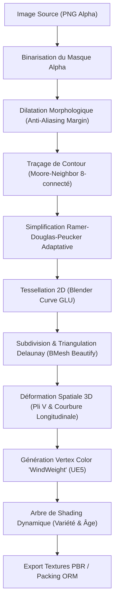

# 🔬 Documentation Technique : Foliage Alpha Silhouette Cutter

Cette documentation détaille l'architecture logicielle, les algorithmes mathématiques, la biomécanique computationnelle et le pipeline de shaders implémentés dans l'add-on **Foliage Alpha Silhouette Cutter**.

---

## 📌 Sommaire

1. [Vue d'Ensemble du Pipeline](#1-vue-densemble-du-pipeline)
2. [Traitement Numérique du Masque Alpha](#2-traitement-numérique-du-masque-alpha)
3. [Traçage de Contour & Simplification Polygonale](#3-traçage-de-contour--simplification-polygonale)
4. [Tessellation & Triangulation Équilibrée](#4-tessellation--triangulation-équilibrée)
5. [Biomécanique & Déformation 3D du Limbe](#5-biomécanique--déformation-3d-du-limbe)
6. [Gradient de Flexion Éolienne pour Unreal Engine (Vertex Colors)](#6-gradient-de-flexion-éolienne-pour-unreal-engine-vertex-colors)
7. [Architecture du Shader Graph Dynamique](#7-architecture-du-shader-graph-dynamique)
8. [Moteur de Génération & Baking PBR](#8-moteur-de-génération--baking-pbr)

---

## 1. Vue d'Ensemble du Pipeline

Le traitement suit une chaîne séquentielle rigoureuse conçue pour maximiser les performances et la fidélité morphologique :



---

## 2. Traitement Numérique du Masque Alpha

### 2.1 Binarisation et Seuillage
Le canal alpha de la texture source est extrait dans un tableau NumPy 2D de dimensions $H \times W$ avec des valeurs normalisées dans $[0.0, 1.0]$.
Le masque binaire $M(x, y)$ est défini par :

$$M(x, y) = \begin{cases} 1 & \text{si } \alpha(x, y) > \tau \\ 0 & \text{sinon} \end{cases}$$

où $\tau$ est le seuil alpha (`threshold`, valeur par défaut $0.08$).

### 2.2 Dilatation Morphologique Contrôlée
Une simple dilatation morphologique peut fermer les échancrures étroites entre les folioles palmées du chanvre (sinus foliaires). Pour éviter ce défaut, l'algorithme applique une dilatation par élément structurant orthogonal d'un rayon de $k$ pixels ($k \in [2, 4]$) :

$$D(x, y) = \bigvee_{|dx| + |dy| \le k} M(x + dx, y + dy)$$

Cette opération garantit qu'aucun pixel opaque n'est tronqué par la discrétisation géométrique sans dénaturer la silhouette découpée.

---

## 3. Traçage de Contour & Simplification Polygonale

### 3.1 Algorithme de Moore-Neighbor Tracing (8-Connectivité)
Le contour extérieur du limbe est extrait sans faire appel à des dépendances lourdes (comme OpenCV). L'algorithme démarre au premier pixel blanc balayé $(x_0, y_0)$ et explore le voisinage de Moore dans le sens horaire selon le critère de terminaison de Jacob :

1. Entrer dans le pixel de bordure actuel $P$.
2. Tester les 8 voisins dans l'ordre trigonométrique à partir du vecteur d'entrée arrière.
3. Dès qu'un voisin blanc $P'$ est détecté, ajouter $P'$ au contour et définir $P \leftarrow P'$.
4. Arrêter lorsque $P = P_0$ et que la direction de transition correspond à l'état initial.

### 3.2 Simplification Polygonale de Ramer-Douglas-Peucker (RDP)
Le contour continu brut comprend plusieurs milliers de coordonnées de pixels. L'algorithme RDP réduit ce nuage en un polygone simplifié préservant les crêtes dentelées du limbe.

Pour chaque segment reliant $A(x_A, y_A)$ et $B(x_B, y_B)$, la distance orthogonale $d(P, AB)$ d'un point intermédiaire $P(x_P, y_P)$ est calculée par :

$$d(P, AB) = \frac{\left| (y_B - y_A)x_P - (x_B - x_A)y_P + x_B y_A - y_B x_A \right|}{\sqrt{(y_B - y_A)^2 + (x_B - x_A)^2}}$$

Si $\max_{P} d(P, AB) > \varepsilon$, le segment est récursivement scindé en ce point maximal.

### 3.3 Formule d'Adaptation Géométrique aux Pixels
Pour adapter la densité de sommets à l'échelle morphologique réelle (Ruderalis $\approx 67\,000\text{ px}$, Sativa $\approx 114\,000\text{ px}$, Indica $\approx 217\,000\text{ px}$), la tolérance $\varepsilon$ est modulée dynamiquement :

$$\varepsilon_{\text{eff}} = \text{clamp}\left( \frac{\varepsilon_0}{\left( \frac{\text{Aire}_{\text{px}}}{A_{\text{ref}}} \right)^\gamma},\; \varepsilon_{\min},\; \varepsilon_{\max} \right)$$

*Paramètres empiriques calibrés :*
- $A_{\text{ref}} = 150\,000\text{ px}$
- $\gamma = 0.35$
- $\varepsilon_{\min} = 2.5\text{ px}$, $\varepsilon_{\max} = 8.0\text{ px}$

> **Résultat :** Les petites feuilles (Ruderalis) ne souffrent plus de sur-géométrie, tandis que les grandes folioles très découpées (Sativa / Indica) conservent la netteté de chaque dentelure.

---

## 4. Tessellation & Triangulation Équilibrée

1. **Remplissage 2D Non-Convexe** : Le polygone simplifié est converti en courbe 2D fermée (`CURVE`, `fill_mode='BOTH'`). Blender applique en interne la tessellation GLU qui gère les polygones auto-sécants ou hautement concaves sans générer de dégénérescence.
2. **Subdivision Intérieure Régulière** : Conversion vers une structure BMesh, suivie d'une subdivision des arêtes (`bmesh.ops.subdivide_edges`) pour créer une grille interne nécessaire aux courbures 3D.
3. **Triangulation Delaunay & Beautify** :
   - Exécution de `bmesh.ops.triangulate(bm, quad_method='BEAUTY', ngon_method='BEAUTY')`.
   - Optimisation de la répartition par `bmesh.ops.beautify_fill(bm, method='AREA')`.
   - Élimine les angles aigus inférieurs à $15^\circ$ et stabilise les normales de surface.
4. **Vertex Reducer (Décimation)** :
   Si le paramètre `unsub_iters` $> 0$, un modificateur `DECIMATE` de type `COLLAPSE` avec un ratio $r = 0.5^{\text{unsub\_iters}}$ est appliqué pour satisfaire les budgets polygone les plus stricts en production temps réel.

---

## 5. Biomécanique & Déformation 3D du Limbe

Une feuille plate (billboard) paraît artificielle sous un angle rasant. Trois équations de déformation sont combinées pour reproduire la morphologie naturelle d'une feuille de chanvre en 3D :

Soit $(u, v) \in [0, 1]^2$ les coordonnées UV normalisées centrées $(\hat{x}, \hat{y}) \in [-1, 1]^2$ définies par :
$$\hat{x} = 2u - 1, \quad \hat{y} = 2v - 1$$

### 5.1 Pli en V Médio-Nervaire ($Z_{\text{fold}}$)
Chaque foliole possède une nervure centrale le long de laquelle les deux hémi-limbes s'orientent vers le haut :

$$Z_{\text{fold}}(\hat{x}, \hat{y}) = -\left(1 - |\hat{x}|^{0.8}\right) \cdot V_{\text{fold}} \cdot \left(1 - 0.6|\hat{y}|\right)$$

### 5.2 Courbure Apicale Gravitaire ($Z_{\text{droop}}$)
Sous l'effet de la gravité et de la turgescence, la pointe s'incurve vers le bas de manière non-linéaire :

$$Z_{\text{droop}}(\hat{y}) = -D_{\text{roop}} \cdot \max(0, \hat{y})^{1.8}$$

### 5.3 Concavité Marginale Latérale ($Z_{\text{side}}$)
Les bords extérieurs s'incurvent légèrement vers le plan inférieur :

$$Z_{\text{side}}(\hat{x}, \hat{y}) = -0.03 \cdot |\hat{x}|^{1.5} \cdot \max(0, \hat{y} + 0.3)$$

### Coordonnée Verticale Résultante :
$$Z(x, y) = Z_{\text{droop}}(\hat{y}) + Z_{\text{fold}}(\hat{x}, \hat{y}) + Z_{\text{side}}(\hat{x}, \hat{y})$$

---

## 6. Gradient de Flexion Éolienne pour Unreal Engine (Vertex Colors)

Pour animer les feuillages dans Unreal Engine 5 via le matériel `SimpleGrassWind` ou des shaders de sommet personnalisés, l'add-on écrit une couche de couleur de sommet (`color_attributes`, type `BYTE_COLOR`, domaine `POINT`) nommée **`WindWeight`**.

Soit $y_{\min}$ et $y_{\max}$ l'étendue en hauteur du maillage, et $y_{\text{junc}} = y_{\min} + 0.25(y_{\max} - y_{\min})$ la zone de jonction du pétiole :

$$W(y) = \begin{cases}
0.0 & \text{si } y \le y_{\text{junc}} \\
\left( \frac{y - y_{\text{junc}}}{y_{\max} - y_{\text{junc}}} \right)^2 & \text{si } y > y_{\text{junc}}
\end{cases}$$

Le poids quadratique simule l'inertie physique : le pétiole est raide, la base de la feuille fléchit modérément, et les pointes des folioles vibrent à amplitude maximale.

---

## 7. Architecture du Shader Graph Dynamique

Le matériau `Mat_Leaf_3D` est composé d'un arbre de nœuds procéduraux connecté à un `Principled BSDF` :

```
[Texture BaseColor] ───┬──────────────────────────────────────────┐
                       ▼                                          │
             [Extracteur de Nervures] (High-pass + Luminance)     │
                       │                                          ▼
                       ├──────> [Masque Variété (Purple / White)] ┼──> [Mix Color Final] ──> Base Color
                       │                                          │
                       └──────> [Masque Sénescence / Bouts Noirs] ┘
                                          │
                                          ├──> [Modulateur Roughness] ──────────────────────> Roughness (0.38 - 0.85)
                                          │
                                          └──> [Normal Map Generator] ──────────────────────> Normal
```

### 7.1 Masque de Sénescence (Trigger Âge $\in [0, 1]$)
- **Chlorose Marginale** : Dès que l'âge dépasse $0.20$, un dégradé radial décolore les bords en jaune soufre.
- **Nécrose Apicale (Bouts Brûlés)** : Pour un âge $> 0.50$, un mélange de distance apicale $\hat{y}$ et de texture de bruit fractal génère les taches brun-noirâtre caractéristiques des feuilles en fin de floraison.
- **Préservation des Nervures** : Le masque de nervures soustrait la nécrose sur les axes conducteurs principaux pour reproduire le jaunissement internervaire réel.

### 7.2 Étalonnage de la Rugosité (Roughness)
Les feuilles saines possèdent un fini soyeux et cuticulaire avec une rugosité d'environ $0.38$. Au fur et à mesure de la sénescence et de la déshydratation, la rugosité monte à $0.85$ sur les pointes nécrosées, éliminant tout reflet spéculaire irréaliste.

---

## 8. Moteur de Génération & Baking PBR

L'opérateur de bake effectue un rendu numérique matriciel via NumPy et l'API d'images Blender :

1. **Carte de Normales d'Espace Tangent** :
   Calculée par convolution d'un filtre de Sobel $3 \times 3$ sur la carte d'élévation dérivée de la texture diffuse et des masques de nervures :
   $$G_x = \begin{bmatrix} -1 & 0 & 1 \\ -2 & 0 & 2 \\ -1 & 0 & 1 \end{bmatrix} * I, \quad G_y = \begin{bmatrix} -1 & -2 & -1 \\ 0 & 0 & 0 \\ 1 & 2 & 1 \end{bmatrix} * I$$
   $$N = \text{normalize}\begin{pmatrix} -G_x \cdot s \\ -G_y \cdot s \\ 1.0 \end{pmatrix}, \quad \text{RGB} = \frac{N + 1}{2}$$

2. **Occlusion Ambiante (AO)** :
   Décroissance parabolique de la distance au bord alpha combinée aux sillons médio-nervaires.

3. **Subsurface Scattering (SSS)** :
   Profil de transmission lumineuse inversement proportionnel à la densité des nervures et à la nécrose.

4. **Packing ORM Standard UE5** :
   - **R** = Ambient Occlusion (AO)
   - **G** = Roughness (Inverse de la brillance)
   - **B** = Metallic (0.0 pour matière organique non-métallique)
