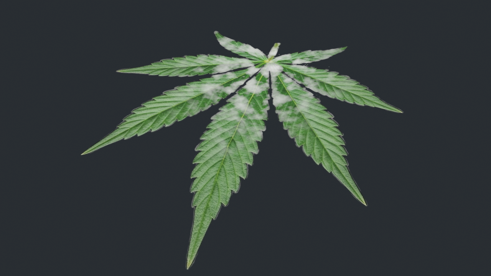

# 📖 Manuel d'Utilisation : Foliage Alpha Silhouette Cutter & Dynamic PBR Baker

Bienvenue dans le manuel d'utilisation de **Foliage Alpha Silhouette Cutter**, un add-on complet pour **Blender (4.2+ / 5.0)** conçu pour transformer des images de feuillage détourées (textures alpha) en maillages 3D ultra-optimisés, prêts pour les moteurs de jeu en temps réel (**Unreal Engine 5**, Unity) et le rendu photoréaliste.

---

## 📌 Table des Matières

1. [Installation & Activation](#1-installation--activation)
2. [Interface & Emplacement](#2-interface--emplacement)
3. [Étape 1 : Choix du Phénotype & Textures](#3-étape-1--choix-du-phénotype--textures)
4. [Étape 2 : Découpe Silhouette & Topologie Adaptative](#4-étape-2--découpe-silhouette--topologie-adaptative)
5. [Étape 3 : Variétés & Pigmentations](#5-étape-3--variétés--pigmentations)
6. [Étape 4 : Trigger Dynamique de Sénescence (Cycle de Vie)](#6-étape-4--trigger-dynamique-de-sénescence-cycle-de-vie)
7. [Étape 5 : Poids du Vent pour Unreal Engine (Vertex Colors)](#7-étape-5--poids-du-vent-pour-unreal-engine-vertex-colors)
8. [Étape 6 : Baking PBR & Exportation de Textures](#8-étape-6--baking-pbr--exportation-de-textures)
9. [Astuces & Bonnes Pratiques](#9-astuces--bonnes-pratiques)

---

## 1. Installation & Activation

### Méthode 1 : Fichier Python Unique
1. Ouvrez Blender (version 4.2 ou supérieure, compatible 5.0).
2. Rendez-vous dans **Édition** > **Préférences** > **Add-ons** (*Edit > Preferences > Add-ons*).
3. Cliquez sur la flèche en haut à droite puis sur **Installer depuis un disque** (*Install from Disk...*).
4. Sélectionnez le fichier `foliage_alpha_cutter.py`.
5. Cochez la case pour activer **Foliage Alpha Silhouette Cutter & Dynamic PBR Baker**.

### Méthode 2 : Installation Manuelle
Copiez simplement le fichier `foliage_alpha_cutter.py` (ou le dossier cloné) dans votre répertoire d'add-ons Blender :
- **Windows** : `%APPDATA%\Blender Foundation\Blender\<version>\scripts\addons\`
- **Linux** : `~/.config/blender/<version>/scripts/addons/`
- **macOS** : `~/Library/Application Support/Blender/<version>/scripts/addons/`

Puis activez-le dans les préférences de Blender.

---

## 2. Interface & Emplacement

Une fois l'add-on activé :
1. Dans la vue 3D (*3D Viewport*), appuyez sur la touche <kbd>N</kbd> pour faire apparaître le panneau latéral droit.
2. Cliquez sur l'onglet **"Foliage Cut"**.

Le panneau est structuré en **5 sections numérotées** correspondant au workflow naturel :
- `1. Phénotypes & Feuilles 3D`
- `2. Découpe & Topologie Adaptative`
- `3. Variété & Couleurs`
- `4. Trigger Dynamique : Cycle de Vie`
- `5. Export / Bake PBR (Unreal Engine)`

---

## 3. Étape 1 : Choix de la Famille, Variété & Textures

L'add-on intègre désormais une architecture multi-familles botaniques développable et extensible :

### 1. 🌿 Famille Cannabis
- **🌱 Sativa (9 folioles)** : Limbe élancé, folioles très fines, longues et effilées. Idéal pour les variétés tropicales.
- **🌿 Indica (7 folioles)** : Folioles larges, trapues et couvrantes, se chevauchant légèrement.
- **🌾 Ruderalis (5 folioles)** : Silhouette compacte, folioles robustes et courtes.

### 2. 🍅 Potager & Jardin (Ex: Solanacées / Tomates)
- **🍃 Feuillage régulier** : Feuilles classiques profondément découpées.
- **🥔 Pomme de terre (*Potato Leaf*)** : Folioles larges, ovales et entières sans dentelures profondes.
- **🌿 Rugueux / Nain (*Rugose Leaf*)** : Feuilles gaufrées, épaisses et très nervurées.

### 3. 🌳 Arbres & 🪴 Plantes d'intérieur
- **🍂 Chêne & 🍁 Érable** : Morphologies de feuilles d'arbres caducs.
- **🪴 Monstera & 🌿 Ficus** : Feuilles de plantes d'ornement et d'intérieur.
- **📁 Personnalisée / Import Libre** : Permet d'importer n'importe quelle texture PNG avec canal alpha.

### Configuration des Chemins d'Images (Inputs Dépliables) :
- Cliquez sur `📁 Déplier Chemins d'Images` pour spécifier vos propres fichiers ou textures personnalisées.
- L'add-on résout automatiquement les fichiers locaux, les dossiers d'installation de Blender et les chemins relatifs.

### Génération & Garantie Anti-Rétrécissement :
Cliquez sur le bouton principal :
```
[ 🌱 Générer la Feuille 3D (Image + Vertex) ]
```
L'add-on :
1. Charge l'image en mémoire.
2. Analyse les pixels du canal alpha avec détection adaptative.
3. Découpe le maillage 3D avec les proportions exactes ($W \times H$) calées sur la **Hauteur Référence (m)** (0.75m par défaut), **empêchant tout rétrécissement cumulatif lors des ré-applications**.
4. Construit l'arbre de shading dynamique et assigne le matériau.

---

## 4. Étape 2 : Découpe Silhouette & Topologie Adaptative

Cette section contrôle la transformation de l'image 2D en maillage 3D triangulé et courbé.


### Paramètres Disponibles :

| Paramètre | Description | Recommandation |
| :--- | :--- | :--- |
| **Hauteur Référence (m)** | Échelle canonique standardisée en mètres préservée à chaque recalcul. | **0.75 m** |
| **Adaptation Pixels Auto** | Calcule automatiquement la surface réelle de la feuille en pixels et ajuste la résolution pour éviter la surcharge de sommets sur les petites variétés comme Ruderalis. | **Coché** (Recommandé) |
| **Marge Silhouette (px)** | Dilatation du masque de découpe en pixels. Évite de rogner le limbe tout en préservant les échancrures étroites entre les folioles. | **2 à 4 px** |
| **Tolérance Contour (px)** | Tolérance de l'algorithme Ramer-Douglas-Peucker. Plus la valeur est basse, plus les dents de scie du limbe sont fidèles. | **3.5 à 5.0 px** |
| **Subdivision Intérieure** | Nombre de subdivisions du maillage intérieur pour permettre une déformation souple en 3D. | **1** (Temps réel) ou **2** (Cinématographique) |
| **Vertex Reducer (Décimation)** | Nombre d'itérations de réduction de maillage (collapse) pour obtenir un budget low-poly très précis. | **0** (Standard) à **2** (Ultra low-poly) |
| **Triangles bien répartis** | Force la triangulation Delaunay équilibrée pour éliminer les faces étirées et les artéfacts d'ombrage. | **Coché** (Recommandé) |

### Bouton de Ré-application :
Si vous modifiez l'un des curseurs ci-dessus, cliquez sur :
```
[ ✂️ Ré-appliquer Découpe & Topologie ]
```
Le maillage de l'objet sélectionné sera instantanément recalculé avec les nouveaux réglages sans altérer son échelle ni réinitialiser le shader.

---

## 5. Étape 3 : Variétés & Pigmentations

Le shader intègre la gestion de variétés botaniques spécifiques avec un respect scrupuleux de l'anatomie végétale :


### 1. 🍃 Classique (Verte / Dorée)
- Feuillage vert naturel, chlorophylle standard.
- En vieillissant, évolue du vert tendre vers des teintes dorées puis ambrées.

### 2. 🍇 Violette / Purple (Anthocyanines)
- Reproduit l'accumulation d'anthocyanines induite par le froid ou la génétique.
- **Teinte sombre violacée** réaliste (rouge-violacé profond).
- **Préservation des nervures claires** : les nervures principales et secondaires conservent un vert tendre / jaune pâle contrasté, comme sur les vraies plantes.

### 3. ❄️ Blanche / Frost (Trichomes Répartis sur la Base)
- Simule la cristallisation des têtes et feuilles résineuses (type *White Widow*).
- **Distribution anatomique stricte** :
  - **Zone active basse ($0.0 \rightarrow 0.40$)** : Les trichomes sont strictement confinés au tiers inférieur de la feuille, proche de l'attache florale ($Y-$).
  - **Densité maximale ($0.0 \rightarrow 0.28$)** : Givre dense et micro-détaillé.
  - **Zone de transition / Fondu ($0.28 \rightarrow 0.40$)** : Fondu progressif (*Smoothstep*) dissolvant les cristaux.
  - **Zone haute ($0.40 \rightarrow 1.0$)** : Strictement $0$ trichome sur les pointes supérieures et le haut du limbe.
- **Triggers et curseurs dédiés** :
  - `Force Visuelle` : intensité globale du givre (0.0 à 2.5).
  - `Début Fade (Y)` : hauteur relative où commence le fondu (défaut 0.28).
  - `Fin Fade / Limite (Y)` : hauteur maximale absolue des trichomes (défaut 0.40).
  - `Accentuation Bords` : renforcement des cristaux le long des crénelures dans la zone active.

### 4. 🎨 Personnalisée
- Permet de choisir une couleur arbitraire avec une pipette ou un sélecteur RGBA tout en conservant le mélange d'ombrage.

---

## 6. Étape 4 : Trigger Dynamique de Sénescence (Cycle de Vie)

Cette fonctionnalité permet de simuler la maturation et le vieillissement de la feuille en temps réel de manière **100% symétrique et homogène sur toutes les folioles** (*partout sur la feuille*) :

```
Trigger Âge : [============== 0.65 ==============]
```

- **Toutes les pointes de toutes les folioles** (supérieures, latérales, inférieures) reçoivent une nécrose apicale brûlée (Canal R).
- **Toutes les marges dentelées** brunissent de façon équilibrée (Canal G).
- **Chlorose dorée et taches de rouille** se diffusent harmonieusement sur toute la feuille.
```



### Comportement selon la valeur du Trigger :
- **🌱 `0.00 - 0.25` : Jeune & Saine**
  - Vert vigoureux ou pigmentation de variété pure.
  - Surface au fini mat velouté (Roughness naturelle ~0.35 - 0.40).
  - Aucune décoloration ni brûlure.
- **🌿 `0.25 - 0.70` : Floraison & Maturation**
  - Jaunissement progressif (chlorose) débutant par les extrémités et progressant le long des marges.
  - Les nervures restent vertes plus longtemps (décoloration internervaire réaliste).
- **🍁 `0.70 - 1.00` : Sénescence & Récolte**
  - Bouts des feuilles noirs/marrons brûlés (nécrose apicale).
  - Taches de rouille et dessèchement localisé sur les folioles extérieures.
  - Rugosité augmentée sur les zones mortes (perte d'humidité, fini sec et cassant).

> **Note :** Si vous modifiez les nœuds manuellement et souhaitez restaurer la configuration originale, cliquez sur `[ Réinitialiser Nœuds Shader ]`.

---

## 7. Étape 5 : Poids du Vent pour Unreal Engine (Vertex Colors)

Pour obtenir des feuillages animés crédibles dans **Unreal Engine 5** (via le material node `SimpleGrassWind`, des pivots foliage, ou `Pivot Painter`), un gradient de poids est automatiquement peint dans les **Vertex Colors** (attribut `WindWeight`) :

- **Base de la feuille (pétiole / attache)** : Poids = `0.0` (Zone fixe, ancrée sur la tige).
- **Corps de la feuille** : Dégradé quadratique lissé.
- **Pointes des folioles** : Poids = `1.0` (Oscillation maximale au gré du vent).

Lors de l'export en `.FBX` ou `.GLTF`, cet attribut est conservé et peut être lu directement dans le matériau Unreal Engine via le nœud `Vertex Color`.

---

## 8. Étape 6 : Baking PBR & Exportation de Textures

La dernière section permet de "figer" l'état dynamique actuel (âge choisi, variété, relief) sous forme de textures 2D universelles compatibles avec tout moteur de jeu.

### Options de Canaux Disponibles :
- [x] **Colour (Col)** : Albedo / Base Color intégrant la teinte exacte, les anthocyanines, et les zones de nécrose.
- [x] **Normal (Nm)** : Carte de normales d'espace tangent calculée avec finesse pour simuler le relief des nervures.
- [x] **Metallic / Rough (Me)** : Carte de rugosité ajustée selon l'humidité et l'âge du limbe.
- [x] **Occlusion (AO)** : Carte d'occlusion ambiante accentuant les creux entre folioles et la nervure centrale.
- [x] **Subsurface (SSS)** : Carte de translucidité pour simuler la lumière traversant le limbe végétal.
- [x] **Pack ORM (UE5)** : Texture combinée optimisée pour Unreal Engine :
  - **Canal Rouge (R)** = Ambiant Occlusion
  - **Canal Vert (G)** = Roughness
  - **Canal Bleu (B)** = Metallic (0.0 pour les végétaux)

### Exportation :
1. Indiquez le dossier de destination dans le champ `Dossier` (par défaut `//Output_PBR/`).
2. Cliquez sur `[ Bake Textures de l'État Actuel ]`.
3. Les fichiers PNG haute résolution sont générés instantanément sans bloquer Blender.

---

## 9. Astuces & Bonnes Pratiques

1. **Orientation des Textures** : Assurez-vous que vos images de feuilles sources sont orientées avec le point d'attache (base/pétiole) vers le bas et la foliole centrale dirigée vers le haut ($+Y$).
2. **Format d'Image** : Utilisez des fichiers PNG 8 bits ou 16 bits avec canal Alpha net (fond 100% transparent).
3. **Double Face (Backface) dans UE5** : Dans le matériau Unreal Engine, pensez à cocher **Two Sided** et à utiliser le Shading Model **Subsurface** ou **Two-Sided Foliage**.
